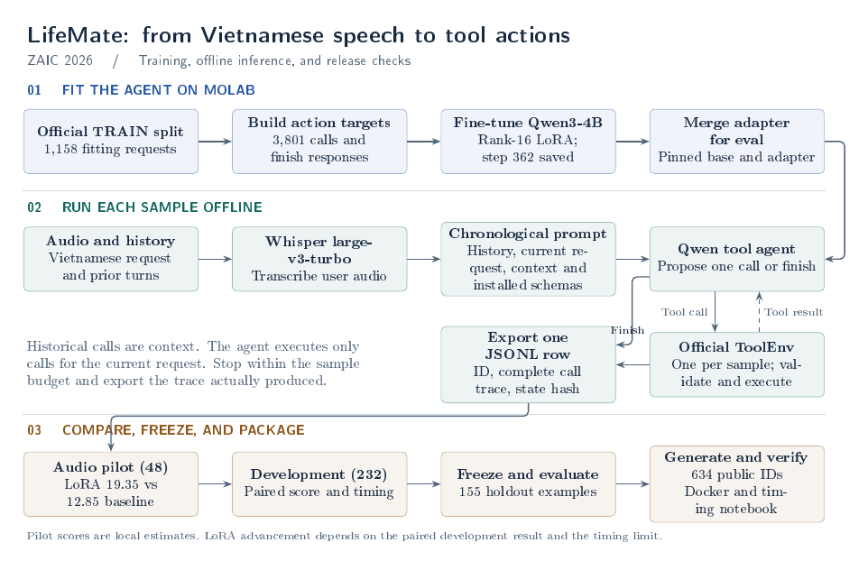

# ZAIC 2026 LifeMate

## Repository layout

```text
.
|-- predict.py, predict.sh         Competition inference entry points
|-- predict_notebook.ipynb         Timing notebook
|-- Dockerfile, start_jupyter.sh   Offline container and notebook launcher
|-- lifemate_*.py                  Shared audio, ToolEnv, scoring, and experiment logic
|-- molab_baseline.py              Molab notebook controls
|-- training_code/                 Model downloads, data preparation, LoRA training, and merges
|-- experiments/                   ASR and agent comparisons, diagnostics, and public exports
|-- validation/                    Fixed development and holdout ID lists
|-- docs/                          Workflow diagram and its source
|-- results/                       Local run reports, adapter backups, and submission files
|-- train+public_test/             Local extracted competition kit
```

Run experiment and training modules from the repository root on molab. For example:

```bash
python -m experiments.evaluate_lifemate_qwen35 --help
python -m training_code.train_lifemate_lora --help
```

Each run has its own subfolder in `results/`. The reported 28.16 submission is under `results/lifemate_asr_lora_001/`. The Qwen3.5 step-72 adapter backup and pilot report are under `results/lifemate_qwen35_001/`. Keep the original kit structure when passing a dataset root. It should contain the `train/` and `public_test/` directories. Git ignores local data, weights, results, virtual environments, and pairing helpers. Store backups separately from the source checkout.

## What to push to GitHub

Push the source and reproducibility instructions: the root Python entry points and helpers, `experiments/`, `training_code/`, `validation/` (ID lists only), `docs/`, `README.md`, the dependency file, and the Docker and notebook entry points. The checked-in notebook has no saved outputs. Follow the official LifeMate portal to obtain the dataset.

Keep `TODO.md` local. It contains operational handoff notes, including a notebook URL and laptop paths. Keep the kit, audio, transcripts, traces, predictions, checkpoint archives, model weights, pairing helpers, and credentials outside GitHub. Use access-controlled storage for any files teammates need. Links into `results/` refer to local artifacts.

From the repository root, stage the source files explicitly and review the staged list before committing:

```bash
git add -- .gitignore .dockerignore README.md Dockerfile requirements.txt lifemate_baseline.py lifemate_eval.py lifemate_experiment.py lifemate_phase2.py lifemate_workflows.py molab_baseline.py predict.py predict.sh predict_notebook.ipynb start_jupyter.sh docs experiments training_code validation
git diff --cached --name-only
git diff --cached --check
```

## Qwen3.5-4B challenger

The challenger replaces the Qwen3-4B agent in the documented 28.16 public submission and keeps its tuned PhoWhisper-medium. Molab uses vLLM 0.23.0 for inference and a separate Transformers 5.22.2 environment for fitting-only LoRA. The pinned Qwen3.5 revision is 851bf6e806efd8d0a36b00ddf55e13ccb7b8cd0a. Both environments use Python 3.12 and torch 2.11.0+cu130. The vLLM environment includes ninja and uses the native sampler.

The warmed-up smoke test passed on seven fitting examples. It exercised a tool response followed by a model decision, with a maximum sample time of 22.739 s. One sample hit the 10-step cap and the stock smoke score was 14.29. Fresh fitting-only LoRA started after the smoke check. The active 12,288-token run retained all 3,801 targets and logged its first optimizer step. After smoke passes, the runner trains a fresh adapter, merges it, and compares the 48-example pilot and all 232 development examples with the 28.16 release. It writes a separate 634-row public JSONL if coverage and timing pass. Development and public scores are reported separately. Upload the challenger manually if appropriate.

The 45-minute run saved step 72 (0.152 epochs). The adapter merged successfully. The trained pilot scored **32.27** vs **36.11** for the 28.16 public release. All 48 samples finished under 8 seconds. See [pilot and training metrics](results/lifemate_qwen35_001/summary.json) and the [verified adapter backup](results/lifemate_qwen35_001/qwen35-4b-lora-step72.zip).

Follow /marimo/results/lifemate-qwen35-001/run-v7.log, smoke-v5/server.log, and challenger-v3/training.log on molab. The comparison is saved to challenger-v3/summary.json and the public JSONL to challenger-v3/public/lifemate_submission_qwen35_4b.jsonl. QWEN35_CHALLENGER_READY marks pipeline completion. See experiments/run_lifemate_qwen35.py for reproduction.

## PhoWhisper-medium fine-tuning experiment

The stock PhoWhisper-medium pilot scored **24.14** against **19.35** for Whisper turbo with the frozen step-362 agent on the same 48 requests. It had 7 wins, 4 losses, and 37 ties. Median/p95/max sample times were 2.60/5.72/6.50 seconds. See [stock pilot report](results/lifemate_asr_lora_001/stock_summary.json).

PhoWhisper-medium was selected for one fitting-only LoRA epoch on molab. The fitting manifest contains 1,158 official latest-request audio/transcript pairs totaling 2.316 hours. Rank 16 targets q/v projections at learning rate 1e-4. The model revision is 55a7e3eb6c906de891f8f06a107754427dd3be79. Only aggregate reports are copied into the repository. The stock full-development run is queued behind training and pilot evaluation.

| Molab log under /marimo/results/lifemate-asr-lora-001 | Completion marker |
| --- | --- |
| stock-pilot.log | STOCK_PILOT_READY |
| training.log (PhoWhisper LoRA) | ASR_LORA_EXPERIMENT_READY |
| turbo-training.log (turbo LoRA) | ASR_LORA_EXPERIMENT_READY |
| stock-development.log | STOCK_DEVELOPMENT_READY |
| final-comparison.log | ASR_FINAL_COMPARISON_READY |

The matched Whisper turbo baseline uses the same 1,158 fitting requests, one epoch, seed 42, rank 16, q/v projections, learning rate 1e-4, and 35-minute training budget. It is queued after the PhoWhisper runs and writes to turbo-training/summary.json. PhoWhisper epoch one completed 145 updates and the trained pilot scored 36.11.

The final comparison runs after both LoRA jobs exit. It reuses completed development scores and evaluates any missing arm on the fixed 232 examples. See final-comparison/summary.json for paired scores, latency, failures, and selection. If a tuned model beats stock PhoWhisper and passes the release score and timing checks, the job generates and validates a 634-row public JSONL in the same folder. Upload the file manually after reviewing the report.

Reproduction scripts are experiments/evaluate_lifemate_phowhisper.py and training_code/train_lifemate_asr_lora.py. Run their --help on molab for the required dataset, checkpoint, and report paths. Use --base pho or --base turbo to select the starting weights explicitly.

### Completed ASR comparison and submission

On the fixed 232 development requests, step-362 Qwen with tuned PhoWhisper-medium scored **33.59**. Tuned turbo scored **32.57**, stock PhoWhisper **26.18**, and the original stock turbo **23.10**. The tuned PhoWhisper gain over the original was **+10.48** (paired grouped 95% interval **+5.29 to +15.76**). Its lead over tuned turbo was **+1.02** (interval **-4.16 to +6.24**). Tuned turbo was faster at p95, **5.00 s** versus **6.14 s**.

The user reported **28.16000** for [the validated PhoWhisper JSONL](results/lifemate_asr_lora_001/lifemate_submission_phowhisper_medium_lora.jsonl), up **4.25 points** from 23.91000. The portal submission ID is pending. All 634 rows passed local coverage and schema validation, the downloaded SHA-256 matched the remote report, and the slowest public sample on molab took 9.592 s. Use tuned PhoWhisper plus the step-362 agent as the release candidate. The [comparison report](results/lifemate_asr_lora_001/final_comparison.json) records the exact metrics and checksum. Verify the selected ASR and agent together in the offline release package.

### Next experiment after 28.16 public

Freeze the submitted configuration and prioritize reproducing it offline. Stage the exact tuned PhoWhisper weights and processor from the molab run, along with the step-362 agent and its pinned base. The Docker recipe already stages the agent adapter. Verify that the ASR staged at saved_models/asr is the merged PhoWhisper model. Compare tool calls and state hashes on a small remote replay, then check offline GPU execution and timing.

For the next score experiment, keep both models fixed and rerun the reference-text diagnostic on the fixed 48 requests using **tuned PhoWhisper** for history. Compare real audio against reference text for the latest request. The earlier 23.10-to-42.38 diagnostic used stock turbo, so the remaining ASR gap needs a fresh measurement. Use the same development split for any follow-up and keep diagnostic references out of inference.

On molab, categorize remaining zero-score multi-call cases by the first point of failure: wrong tool, wrong argument or state change, or stopping before required calls. Tuned PhoWhisper's multi-call score is **28.49 on 160 development examples**. If failures persist with reference text, start one fitting-only agent experiment on the dominant category. For premature stops, for example, rebalance full trajectories with prerequisite observations and final-stop targets. If reference text repairs most of the failures, prioritize the recurring speech errors it repairs. Keep Qwen3.5 as a follow-up challenger once this diagnostic is available.

Compare the candidate with the current **36.11 pilot / 33.59 development** release, using paired scores, multi-call behavior, false actions (current 6), and full sample latency. Use public scores to confirm the selected release after development. The tuned turbo is a latency fallback with 5.00 s development p95 versus 6.14 s for tuned PhoWhisper, and an inconclusive 1.02-point score gap.

### Tuned PhoWhisper diagnostic result

Reference text for the latest request lifted the real-audio baseline from **33.59 to 43.49** on 232 development requests (+9.90, 43 wins, 17 losses). Multi-call score rose from **28.49 to 40.67**. Of 84 remaining zero-score multi-call cases, the first ordered divergence was an argument in 46, a tool name in 35, a missing suffix in 2, and an extra call in 1. Alternate call orders can be valid, so use these counts to prioritize review. False actions on empty requests rose from 6 to 9 with reference text.

Start the next fitting-only agent experiment with argument grounding in prior tool results and user context. Check repeated ID/account/device selections against the fitting traces before defining the treatment. Keep tuned PhoWhisper fixed and measure the result on real audio against 36.11 pilot and 33.59 development. [Development diagnostic](results/lifemate_pho_diagnostic_001/development_summary.json) and [aggregate field audit](results/lifemate_pho_diagnostic_001/development_argument_fields.json).

The offline molab replay reproduced five of five public rows exactly, including calls and state hashes. Python networking was blocked during replay. The two merged models contain 4,786,326,016 parameters combined, and the longest replay took 4.432 s. [Replay report](results/lifemate_pho_diagnostic_001/offline_replay.json) and [release checksums](results/lifemate_pho_diagnostic_001/release_manifest.json). Docker build and container execution still require a remote Docker host.

## Model shortlist for the next agent — 13 November 2026

These are untested candidates for this repository. Benchmark claims from model authors do not establish LifeMate performance. Keep the existing 23.91-public-score release until an alternative passes the active evaluation gates.

| Component | Candidate | Recommendation |
| --- | --- | --- |
| ASR | [vinai/PhoWhisper-large](https://huggingface.co/vinai/PhoWhisper-large) | First ASR trial with the existing Qwen3 step-362 agent. Vietnamese-specialized, 1.55B parameters. Replace turbo for all user audio. |
| ASR | [vinai/PhoWhisper-medium](https://huggingface.co/vinai/PhoWhisper-medium) | Second ASR candidate if large is slow, or the preferred smaller partner for full Qwen3.5-4B. 0.769B parameters. |
| ASR reserve | [openai/whisper-large-v3](https://huggingface.co/openai/whisper-large-v3) | Full multilingual decoder alternative, roughly 1.55B. Reserve for a later round; not an automatic third pilot. Improvement over turbo on this task is unproven. |
| Agent | [Qwen/Qwen3-4B-Instruct-2507](https://huggingface.co/Qwen/Qwen3-4B-Instruct-2507) | Lower integration risk: Qwen3 architecture, non-thinking model, author-reported improvements in tool use. Train a fresh task adapter rather than moving step 362 onto different base weights. |
| Agent | [Qwen/Qwen3.5-4B](https://huggingface.co/Qwen/Qwen3.5-4B) | Priority new-architecture challenger after ASR isolation. Needs its own loader/template/parser compatibility check and fresh LoRA. |

PhoWhisper was tuned on 844 hours covering Vietnamese accents. Its official table reports 1.55B/769M for large/medium and only modest differences on several benchmarks; our downstream score and latency decide. Both use BSD-3-Clause. [Author evidence](https://github.com/VinAIResearch/PhoWhisper).

### Qwen3.5 decision and parameter budget

Yes, test Qwen3.5, but do not switch the release yet. The full checkpoint includes vision and is **4,659,865,088 parameters**, according to [HF metadata](https://huggingface.co/api/models/Qwen/Qwen3.5-4B), checked on 13 November. Its repository was created 27 February 2026; observed revision is `851bf6e806efd8d0a36b00ddf55e13ccb7b8cd0a`. Archive pre-cutoff weight history before adoption. Apache-2.0 license. Use explicit `enable_thinking=False`, enforce 16,384 context and the task deadline. [Model card](https://huggingface.co/Qwen/Qwen3.5-4B).

| Proposed deployment | Approximate total | Size assessment before exact audit |
| --- | ---: | --- |
| Existing Qwen3 + PhoWhisper-large | 5.572B | Fits nominal budget; omit turbo |
| Full Qwen3.5 + current turbo | 5.469B | Fits nominal budget |
| Full Qwen3.5 + PhoWhisper-medium | 5.429B | Fits nominal budget |
| Full Qwen3.5 + PhoWhisper-large or full large-v3 | 6.210B | Exceeds limit; do not deploy |

Count adapters and all other components too. Text-only extraction is a separate engineering and eligibility check, not an assumed discount. Recount actual retained weights if exploring it. Do not combine two agent checkpoints in the release.

### Controlled experiment order

1. Existing Qwen3 step 362 + PhoWhisper-large; if needed use medium as the second ASR pilot. Follow the active 48-to-232 evaluation gates.
2. Hold ASR fixed and smoke-test Qwen3.5 without the old adapter. Use a compatible pinned runtime in a separate molab environment, preserve the baseline environment, and verify tool-call parsing, tool observations, stopping, offline inference, and latency. This test diagnoses integration; a weak zero-shot score alone does not establish that a trained candidate is worse.
3. Train a new Qwen3.5 LoRA only on the existing 1,158 fitting requests. Re-render assistant-only targets with its own tokenizer/template, audit target retention, and inspect actual module names before choosing LoRA targets. Never attach the Qwen3 adapter to Qwen3.5. Use a recorded bounded training budget and compare the trained candidate with step 362 under the same ASR.
4. If migration cost or measured speed is poor, try Qwen3-4B-Instruct-2507 with its own fresh fitting-only adapter. Do not run an unrestricted model sweep.
5. Combine separately demonstrated improvements only in an eligible configuration. If a preferred pairing exceeds the cap, use a smaller ASR and measure it anew. Compare all final configurations on real audio with complete transcription time, not cached transcripts.

## Active plan for the next agent — 13 November 2026

This section and the first checklist in TODO.md supersede the historical experiment instructions below. This is a planning handoff; no new remote job was launched for it.

**Next experiment: replace the speech recognizer while freezing the step-362 agent.** The completed 232-example diagnostic improved from 23.1045 with audio to 42.3780 with reference text for the latest request (64 wins, 12 losses). Multi-call score rose from 16.63 to 40.09. Reference text is diagnostic only: this is neither an achievable-score promise nor a submission candidate. Remaining first-tool and stopping errors also require agent improvements later.

Keep the existing 634-row `results/lifemate_lora_002/lifemate_submission_step362.jsonl` as the release fallback (user-reported public score 23.91000). The baseline uses step 362, chronological native tool history, and greedy Whisper; fixed pilot score is 19.345238095 and development score is 23.104474548. Do not repeat the rejected epoch continuation, beam-3, bill-payment prompt, or matched-ASR training unchanged.

1. Research and select one Vietnamese-capable ASR candidate using official model cards, release history, license, and exact parameter count. Verify the recorded competition eligibility rules against the official source, including the release cutoff. Pin the model revision and document offline dependencies before downloading weights on molab.
2. Count every deployed component. The recorded constraints are LLM <5B and total <6B parameters. Qwen is approximately 4.022B and existing Whisper turbo approximately 0.809B: retaining both leaves less than about 1.169B for an additional recognizer, before other components. Prefer replacing Whisper for all user audio if the alternative cannot coexist within the limit. Count exact parameters before approval; quantization does not reduce parameter count. Cached Whisper history is not a deployable workaround for the size limit.
3. Implement an explicit ASR backend option in the shared inference path, preserving default behavior. Hold agent weights, prompt, tool handling, and decoding fixed. Evaluate the actual deployable history/current-request configuration, including all transcription time. Use a small remote smoke test, then the existing fixed 48-example audio pilot. Advance only if score exceeds 19.345238095, every sample is below 30 seconds, and outputs are valid.
4. Confirm on all 232 development examples. Require score above 23.104474548, no additional false actions on the 17 empty-call examples (baseline 10), no regression in the 160-example multi-call score (baseline 16.6265), and no sample reaching 30 seconds. Report paired wins/losses and a grouped bootstrap confidence interval for the score difference. If the interval includes zero, label the gain tentative and do not replace the release on that evidence alone. These are conservative project promotion gates, not organizer rules.
5. If ASR passes, freeze it and complete remote offline/script/notebook parity and packaging checks before producing a new 634-row JSONL. If ASR fails, preserve step 362 and use aggregate error categories to choose one fitting-only agent experiment aimed at wrong first tools, multi-call completion, or correct stopping. Change one factor at a time and compare against the frozen audio baseline.

Use at most two eligible ASR pilot candidates in this round. Stop after three failed full-development candidates across subsequent experiments, or when release validation needs the remaining compute time. Save each experiment's configuration, source/model hashes, metrics, timing, and outcome before moving on. Detailed execution tasks and required artifacts are in [TODO.md](TODO.md#active-execution-checklist--13-november-2026). All model work stays on molab; raw private traces stay there. Public scoring is confirmation after selection, never a training signal.


Vietnamese audio → Whisper large-v3-turbo → Qwen3-4B → official ToolEnv → JSONL predictions. Run model downloads, inference, evaluation, training, and packaging tests on remote compute. The laptop is for source and documentation only. GPU availability is already confirmed by the user.

## Current state

The latest user-reported public score is **23.91000**, associated with the delivered step-362 LoRA candidate. Its local development score is **23.10/100** on 232 examples. The full 634-row submission is validated and saved in the repo. The earlier request-last model scored 13.55000 publicly, 12.98 on development, and 11.06 on the 155-example holdout. See the next-step plan below and [TODO.md](TODO.md) for acceptance checks.

| File | Purpose |
| --- | --- |
| `lifemate_experiment.py` | Runs a pilot, development comparison, holdout, or public export |
| `lifemate_baseline.py` | ASR, tool agent, official trace/hash, JSONL writer |
| `molab_baseline.py` | marimo controls for a smoke or full inference run |
| `lifemate_eval.py` | Fixed TRAIN splits and estimated competition scorer |
| `validation/development.txt` | 232 examples for iteration |
| `validation/holdout.txt` | 155 examples reserved for final evaluation |

## LifeMate workflow



[TikZ source](docs/lifemate_workflow.tex) · [Vector PDF](docs/lifemate_workflow.pdf)

The rank-16 LoRA run reached step 362 and scored **19.35/100** on the 48-example audio pilot versus **12.85/100** for the chronological baseline. On all 232 development examples, LoRA scored **23.10/100** versus **13.29/100** (+9.81 points, 40 wins, 181 ties, 11 losses). State match rose from 28.02% to 39.22%, and tool-call F1 from 19.82% to 39.81%. Molab median, p95, and maximum times were 1.97 s, 5.00 s, and 9.18 s. See [TODO.md](TODO.md#lora-run-on-molab) for the verified backup and remaining errors. The latest user-reported public score is **23.91000** for the delivered LoRA candidate.

## Current next step

Investigate current-request ASR with the selected step-362 adapter. Reference-text diagnostics scored 43.19 for the latest request and 41.67 for all user turns, compared with 19.35 from audio on the fixed pilot. The first decoding comparison is complete. Review the private transcript differences before choosing the next correction. The full epoch continuation scored 19.10 and was not promoted. Detailed execution steps, paths, and promotion criteria are in [TODO.md](TODO.md#next-agent-handoff--asr-investigation). The older training-first plan below records the previous stage.

The three-beam experiment completed on molab. Greedy replay matched step 362 on all 48 per-example scores. Three beams scored **18.30 vs 19.35** with 2 wins, 43 ties, and 3 losses. Wrong first tools increased from 8 to 13. Median/p95/max latency was 2.28/4.86/6.17 seconds, with no samples at 30 seconds. Normalized whitespace/punctuation-delimited token error was 47.54% versus 31.48% for greedy across 1,096 reference tokens. This aggregate can be sensitive to a few large transcript errors. The candidate did not advance. [ASR result](results/lifemate_lora_002/asr_beam3_001.json).

Next, inspect the private traces for large insertions, omissions, and meaning-preserving differences. Use that review to choose an ASR correction or a fitting-only experiment that trains the agent to handle Whisper-style text. Keep the frozen step-362 audio run as the benchmark.

The follow-up audit found 61 substitution spans and one deletion span across the 15 pilot examples that improved with current-request reference text. Three spans covered at least four tokens and five examples differed in digit strings, which may include formatting differences. No greedy transcript in that group was at least 25% shorter than its reference. One three-beam transcript expanded from 25 reference tokens to 165 tokens with repetition.

The fitting-only Whisper cache completed on molab. It contains 1,158 unique fitting IDs and excludes all development and holdout IDs. Greedy output differed after normalization on 1,139 requests, with 406 digit-string differences. A conservative screen identified 92 short substitutions for manual review. These are review candidates and have not been approved for training. [Cache summary](results/lifemate_lora_002/fitting_asr_001_summary.json). The private cache and review queue are under /tmp/lifemate-phase2. Follow the run with `tail -F /marimo/results/lifemate-lora-002/fitting_asr_001.log`. `FITTING_ASR_READY 1158` marks completion. The cache generator is [training_code/cache_lifemate_fitting_asr.py](training_code/cache_lifemate_fitting_asr.py).

After the cache completes, review a sample of transcript substitutions against the intended actions. Prepare a mix of original text and verified Whisper variants for a short LoRA experiment. Only pair a Whisper transcript with the original trajectory when it still supports the same action and arguments. Keep genuinely ambiguous or corrupted transcripts out of that treatment. Compare against step 362 on the fixed audio pilot, followed by development if the pilot improves.

The on-molab automated transcript screen retained 26 of the 92 flagged pairs. It checked semantic agreement in both directions with the pinned base Qwen model. This is a conservative automated filter and can still mislabel a pair. The matched trial uses those 26 fitting requests and 128 fixed background requests in both arms, totaling 498 targets per arm. The treatment substitutes the latest transcript in 77 targets. Both arms initialize from step 362 with a fresh optimizer and the same seed, data order, and one-epoch settings. The runner checks that both arms retain every target and finish the epoch before comparing real-audio pilots.

The matched pilot is complete. Step 362 scored **19.35**, the matched clean-text control **13.79**, and the Whisper-trained arm **17.26**. Whisper text gained 3.47 points over the matched control (2 wins, 46 ties), but lost 2.08 points against step 362 (one loss, 47 ties). Step 362 remains selected. [Matched ASR results](results/lifemate_lora_002/asr_matched_001.json).

The full TRAIN development transcript diagnostic is complete. With step 362 fixed, reference text for the latest request raised the score from **23.10 to 42.38** across 232 examples (+19.27, 64 wins, 156 ties, 12 losses). Multi-call examples improved from **16.63 to 40.09** (160 examples, 51 wins and 5 losses). The score on the 17 empty-call examples stayed at 41.18. Wrong first tools fell from 54 to 38, and the 20 missing traces on requests with expected calls fell to zero. Earlier turns still used ASR. [Diagnostic summary](results/lifemate_lora_002/transcript_diagnostic_development_001.json).

The next benchmark should compare a stronger eligible Vietnamese ASR candidate against greedy Whisper using actual audio and the frozen step-362 agent. Screen on the fixed pilot, then use all 232 development examples to confirm gains, especially on multi-call requests. Verify model eligibility, offline loading, size, and latency before promotion. The reference-text run measures sensitivity to the latest transcript and leaves substantial agent errors to address.

## Plan after the 23.91000 public score

The user reports **23.91000** for the latest public submission on 13 November 2026, an increase of **10.36 points** over 13.55000. This is recorded against the delivered step-362 LoRA candidate from the conversation context. The portal submission ID has not been independently checked. Its local development score is 23.10/100. Public and development scores use different examples.

The complete [LoRA submission](results/lifemate_lora_002/lifemate_submission_step362.jsonl) passes coverage and format validation for all 634 public IDs. The public log records median/p95/max times of 2.01/4.61/7.21 seconds on molab, with no sample at 30 seconds. SHA-256 is `5615018ef3f653d7683bcedf667f465ae20220bc8b1f232ff1e811cf7265b0f1`.

1. **Preserve a working release.** Keep step 362, the submitted JSONL, pinned base models, source snapshot, and dependency versions together. Shared inference replay already matched all 48 pilot predictions. Update the Docker recipe to include the selected adapter and PEFT dependency and select chronological inference in both entry points. Verify the image remotely with networking disabled, check script/notebook output parity, and resolve the scoring hardware/CUDA requirements.
2. **Complete the first training epoch as the next score experiment.** Audit the saved training log for retained targets, split exclusions, assistant loss masking, and sequence-length coverage. Resume checkpoint 362 with its original optimizer, scheduler, data order, and settings into a separate output directory. Keep the original adapter intact. The run stopped at 0.762 epochs, so the remaining training is estimated at roughly 30 minutes from prior throughput. Use a 45-minute cap. Compare the resulting adapter on the fixed 48 audio examples, then all 232 development examples if the pilot improves.
3. **Inspect the remaining multi-step and stop errors.** The current model still scores zero on 126/160 multi-call requests and takes unnecessary actions on 10/17 empty-call requests. Review first-action confusion and argument provenance on development. If continuation plateaus, test fitting-only rebalancing of multi-step and empty-call trajectories as a separate experiment. Preserve prerequisite observations and final-stop targets. Check exact argument differences against the scorer's fuzzy-field rules before assigning errors.
4. **Measure ASR impact again with LoRA.** Run current-request and full-history reference-text diagnostics on the fixed development pilot using the selected adapter and identical chronological formatting. Use this to decide whether a later ASR experiment is justified.
5. **Freeze and evaluate the selected improvement.** Use 23.10 development and 19.35 pilot as the current comparison scores. Record paired wins/losses, state match, call F1, empty-call behavior, and latency. Use grouped uncertainty estimates for small gains. The 155-example holdout has already been used for the earlier model. Disclose any repeated aggregate evaluation and keep it out of fitting and tuning. A partition carved from data already used by step 362 cannot provide an untouched estimate for this model.

The bill-payment prompt experiment is rejected at 17.26 versus 19.35 on the pilot. Continue selecting changes from TRAIN evidence. Generate another full public submission after a candidate improves full development. Stop after three full-development candidates without improvement or when release verification needs the remaining time. This turn records the plan and result without launching another GPU run.

The continuation finished epoch one at step 476. Its 48-example pilot scored **19.10 vs 19.35** for step 362, with 4 wins, 40 ties, and 4 losses. False actions on empty requests fell from 3 to 1, but the overall pilot score fell by 0.25 points. Step 362 remains the release candidate. The step-362 transcript diagnostic scored **43.19** with reference text for the current request and **41.67** with reference text for all user turns, versus **19.35** from audio on the same 48 examples. Prioritize current-request ASR. First audit names, dates, numbers, and action words on those TRAIN examples, then test one decoding change with the same Whisper weights and frozen LoRA adapter. Select on real audio and verify timing before promoting.

## Problems to solve

| Priority | Problem | Next check |
| --- | --- | --- |
| 1 | The LoRA development winner needs a reproducible release path. | Preserve step 362 as the reference, integrate it into the shared prediction path, and verify offline loading and timing. |
| 2 | Wrong first tools and missing actions are still the main measured agent failures. | LoRA reduced wrong first executed tools from 106 to 54 and missing traces from 33 to 20. Inspect multi-step failures first and track false actions on empty requests as a regression check. |
| 3 | Correct tool names still yield incorrect arguments or final states. | Inspect development-only cases for missing IDs, names, amounts, dates, and multi-step dependencies. Test one schema-aware correction at a time. |
| 4 | Audio and history transcription can reduce downstream accuracy. | The pilot scored 10.76 from audio, 11.94 with the current request supplied as reference text, and 12.64 with all user turns supplied as reference text. Prioritize ASR changes only if residual audio failures justify them. |
| 5 | A new candidate needs a declared evaluation protocol and export. | Keep training and development IDs separate. Report any reuse of the 155-example holdout and validate all 634 new public rows from the frozen candidate. |
| 6 | The final Docker image and target-hardware timing need verification. | If LoRA advances, include the selected weights and chronological prompt in both entry points. Build remotely, test with networking disabled, verify output parity and the 30-second limit, then export and checksum the image. Confirm the scoring GPU and CUDA requirement with the organizers. |

## Optimization after the 13.55000 public score

The user reports an official public score of **13.55000** for the delivered candidate. The portal result has not been independently inspected. The corresponding local development and holdout estimates were 12.98 and 11.06 out of 100. These are different datasets, so their difference does not measure scorer bias. Keep the delivered JSONL, its source snapshot, and model revisions as the reference for this next phase. A ranking claim requires the leaderboard context.

The strongest measured improvement came from Qwen's native tool format followed by placing the latest request after the history. On the earlier native variant, all 33 expected contact searches were missed, and some contact requests triggered unrelated actions. The request-last winner needs its own failure breakdown before treating those counts as current. Replacing only the latest request with reference text improved an earlier pilot from 5.56 to 6.94. History still used ASR in that diagnostic, so total ASR impact remains uncertain.

### 1. Instrument the selected baseline and isolate the failure

Add optional development diagnostics containing sample ID, current and history transcripts, prompt token count, proposed action, schema-validation error, official tool response, and stop reason. Store these restricted traces outside Git and public notebook outputs. Limit logging to permitted tool observations. Preserve exactly one ToolEnv and its full call trace.

Run the current winner on the fixed 48-example pilot with logging. Classify first-decision failures separately from later failures. Count wrong tool, skipped lookup, wrong argument, premature finish, clarification errors, context exhaustion, and ASR-related mistakes. Report score, state match, call F1, and latency by history/no-history and gold call count. Validate the scorer with official gold replay and deliberately incorrect traces. Check exact match, fuzzy matching, empty-call behavior, and the time boundary independently.

Run two TRAIN-development-only transcript diagnostics using the same candidate: reference text for the current request, then reference text for current and historical user audio. Keep these results marked as diagnostics. Model selection continues to use full audio input. The second diagnostic distinguishes history transcription errors from failures to interpret history.

Run the implemented phase-2 comparison from the repository on molab using the extracted kit and the pinned local snapshots. The runner uses TRAIN development only and writes a separate score report per variant. Full development follows automatically when the chronological audio pilot beats the baseline and meets the time limit.

```bash
python lifemate_phase2.py --data-root "$DATA" --asr-path "$ASR" --agent-path "$AGENT" --output results/phase2_001
```

Add `--diagnostics /private/path/events.jsonl` to retain restricted transcript and tool-event traces. Use a fresh output directory and file on each run.

### 2. Represent conversation turns explicitly

The current implementation places historical user turns, assistant text, and prior tool activity inside one JSON-bearing user message. Test chronological user/assistant/tool messages using the model's native format, followed by the latest user request. Preserve the current time, timezone, profile, installed tools, and relevant observations. Historical actions are already applied and must be represented as context without executing them again.

Compare the full chronological representation with a deterministic compact representation of recent turns and their relevant tool results. Avoid silently dropping information required by references such as “send it to her.” First test formatting alone. Use a separate ablation for history compression. Retain all installed tools initially so a formatting change can be assessed without a tool-selection change.

Check generated output before accepting plain text as a finish. The current parser treats any nonempty output without a tool-call tag as finished. Diagnostics should distinguish a valid final response from a malformed or truncated call. Test a single format-repair attempt only for demonstrably malformed output, within the existing time/token budget. Never force a tool on an out-of-scope request.

### 3. Train the agent on official fitting trajectories

If conversation formatting still leaves large tool-selection errors, the next substantial candidate is LoRA supervised fine-tuning of the pinned Qwen3-4B. Use only the 1,158 fitting examples outside the fixed 232 development and 155 holdout IDs. Use the official provided gold tool calls and corresponding tool results. Do not use final-state labels or future tool responses as model inputs.

Build each target from the context available immediately before that action. Include native tool signatures, historical turns, the current request, and only earlier observations in the current trace. Train the next tool call or terminal response with loss on assistant targets only. Include empty-call requests, clarification, read-before-write dependencies, multi-step requests, and the final stop. Keep repeated requests grouped and exclude evaluation examples from training and retrieval.

Start with one short run, one epoch and LoRA rank 16 as provisional engineering defaults. Inspect training-example formatting and a small batch before the full run. Log seed, learning rate, effective batch size, sequence truncation, fitted sample IDs, target-token coverage, and elapsed GPU time. Set a concrete duration limit before launch based on measured throughput. Evaluate the first checkpoint on the pilot, then all 232 development examples if it improves. Run a second epoch only if the measured result warrants it. Merge the selected adapter for inference and verify offline loading, total parameters, output agreement, and latency.

The diagnostic runner and fitting data builder are implemented. Use `python -m training_code.prepare_lifemate_sft --data-root "$DATA" --output /private/path/fitting.jsonl` to prepare assistant targets for chronological training. Add `--audit-ids` if a fresh audit partition was reserved. Step 362 is the current development winner. Evaluate subsequent changes against this frozen adapter on the same audio inputs.

### 4. Optimize schemas and arguments using the remaining errors

If tool overload remains a measured problem, test a lightweight first stage that selects relevant apps, then supplies their tools plus prerequisite read tools and clarification. Allow multiple apps and a fallback to the full installed set. Measure reference-tool coverage on development before running the agent. A router that removes a necessary tool cannot recover downstream.

Use schema validation and observed tool results to repair arguments. Prioritize actual failure classes such as missing IDs, relative dates, Vietnamese amounts, and names. Retrieve IDs through permitted reads and use only unambiguous observations. Keep normalization specific to documented argument semantics. Evaluate one repair at a time, including requests where ambiguity should lead to clarification. The earlier broad lookup prompt and strict clarification guard did not improve full development enough to adopt them unchanged.

### 5. Revisit ASR when the diagnostic supports it

Measure transcript errors on the latest request and history separately, especially names, numbers, dates, and omitted words. If reference transcripts materially improve downstream scores, compare a second eligible ASR checkpoint or decoding configuration on the same audio pilot. Verify release eligibility, license, total model parameters, offline operation, and whole-sample timing. Increasing reasoning tokens already caused two of the first five examples to reach the 29-second internal budget, so unrestricted reasoning is a poor next default.

### Evaluation and promotion for every loop

Keep the 48-example pilot fixed and use it for quick screening. Promote promising changes to the same 232-example development set. Compare with the selected step-362 LoRA baseline at 23.10 using paired score deltas, wins/losses, state match, tool F1, failure categories, and median/p95/max milliseconds. Record one primary change per experiment and preserve its exact source, weights, flags, IDs, and logs. Estimate uncertainty with paired resampling over duplicate-request groups when gains are small. The pilot is repeatedly tuned and cannot serve as an independent final estimate.

The existing 155-example holdout has already been evaluated once. Keep it out of training and per-example failure analysis. Reusing its aggregate score for a later frozen candidate must be disclosed as a repeated holdout evaluation. If a fresh final estimate is needed, reserve a new grouped audit partition from the fitting pool before training, exclude it from all fitting/retrieval, and record any previous exposure.

The next milestone is a reproducible full-development gain beyond 23.10 while staying within the time budget. After that, freeze the candidate, evaluate the reserved set under the declared protocol, generate complete public predictions, and validate the output. Use the official public score as a coarse external check. Keep optimization decisions grounded in TRAIN evidence rather than public examples or labels. No specific leaderboard score can be promised from the current measurements.

## Run the experiments yourself on molab

Copy `lifemate_experiment.py`, `lifemate_baseline.py`, `lifemate_eval.py`, and the whole `validation/` folder to the same molab workspace. You can transfer these source files through the notebook file browser or your code repository. Obtain the official kit separately and follow the package setup below. Agent pairing is optional for this workflow.

From the molab Linux shell, start with the two variants on the same fixed 48 TRAIN development examples. Set `DATA` to the extracted directory containing `train/` and `public_test/`.

```bash
DATA=/path/to/extracted/train+public_test
python lifemate_experiment.py pilot --data-root "$DATA" --output results/pilot_001
```

When both variants finish, send `results/pilot_001/summary.json` back in chat. It includes estimated scores, paired wins and losses, timing, and stop counts. Keep the full score reports, predictions, and logs in your authorized storage. If the command stops, send the failing log's error lines after removing credentials and signed links. Each invocation requires a fresh output directory. To rerun only the failed variant, add `--variant base` or `--variant reuse_reads` and pick a new directory.

If you have time to run the full comparison before sending results, use the 232-example development stage and share its `summary.json` too.

```bash
python lifemate_experiment.py development --data-root "$DATA" --output results/development_001
```

After selecting and freezing a variant on development, set `VARIANT` to the selected single variant. The holdout evaluates all 155 reserved IDs. The public stage generates and checks the 634-row artifact for this kit. Use the same code, variant, and pinned model directories for both stages. For pinned offline model folders add `--asr-path PATH --agent-path PATH --offline` to each command.

```bash
python lifemate_experiment.py holdout --variant "$VARIANT" --data-root "$DATA" --output results/holdout_001
python lifemate_experiment.py public --variant "$VARIANT" --data-root "$DATA" --output results/public_001
```

The public prediction file is `results/public_001/$VARIANT.jsonl`. Check `summary.json` for coverage and timing. The default public output uses the kit's three fields. The organizer's timing-field requirement and Docker checks remain in TODO.

## Optional agent pairing

1. Open the existing molab notebook. Use its **Pair with an agent → Codex** dialog to get the current pairing prompt and sandbox URL. The notebook browser URL and the pairing URL are different. Old sandbox URLs can expire with HTTP 410.
2. Use the installed `marimo-pair` skill. Read its current instructions and run the dedicated first kernel command `import marimo._code_mode as cm; help(cm)` successfully before task-specific code. Keep tokens in the supported authentication mechanism, never in Git, these docs, logs, or notebook outputs.
3. In Windows PowerShell, avoid passing the multiline generated prompt as a CLI argument. Run `uvx marimo@latest pair prompt --url 'CURRENT_SANDBOX_URL' --with-token --codex | Out-String` into a variable, check `$LASTEXITCODE`, copy it with `Set-Clipboard`, launch `codex`, then paste the prompt. Replace the placeholder with the raw URL, not Markdown link syntax. The `codex` command must be installed/on PATH; the existing paired desktop agent can instead use the skill's helper directly.
4. Use live code-mode APIs to edit cells and manage packages. Do not overwrite the running notebook's `.py` file. Scratchpad assignments do not persist; durable notebook changes belong in cells. Inspect only project-related state and avoid dumping all cells or environment variables.
5. Inspect existing job logs and completed outputs before launching another run. Run one inference experiment at a time on the GPU. Do not re-execute a launch cell merely to refresh status.

[Official molab guide](https://docs.marimo.io/guides/molab/) · [Pairing overview](https://molab.marimo.io/pair)

## Prepare the remote workspace

Transfer the scripts and `validation/` from this repo to molab, or clone the authorized code repository there. GitHub mirroring can load notebook source, but does not replace staging helper modules, data, and models. Never commit the restricted kit, tokens, or private traces to a public repository. Keep source changes synchronized back to this repo before ending a session.

Install `transformers==4.57.1`, `soundfile`, and `scipy` using the notebook package manager or `ctx.packages.add`. Use molab's CUDA PyTorch. The baseline sets `USE_TF=0` before importing Transformers to avoid the observed Keras 3 conflict. If Transformers was already imported in the kernel, launch inference in a fresh Python process.

Download the official authorized kit remotely. Set `DATA` to the directory containing `train/` and `public_test/`, not the archive or its parent wrapper. Kit v3.2.0 has 1,545 TRAIN and 634 PUBLIC_TEST records. Do not modify the official simulator or inspect environment state files. Save results outside the dataset tree. Pin model revisions and dependencies in the run record before final validation.

Molab storage is limited. Source files and qualifying file-browser uploads persist under the documented policy; arbitrary generated result files and large model caches must not be assumed durable. Export predictions, reports, logs, selected source, and run metadata to authorized durable storage after each completed variant. `/tmp` is temporary. Check recovery before a long job. [Storage policy](https://marimo.io/pages/molab/storage)

## Iteration 1: clarification behavior

The pilot recorded 98 clarification calls for the default and 110 for `reuse_reads`, compared with four in the 48 reference traces. The `resolve_missing` candidate keeps the `reuse_reads` behavior, directs the model to try relevant lookups, checks clarification arguments against the intended tool's schema, including fields required only by the current request, and ends the turn when the simulator is waiting for the user.

Run this comparison on molab after transferring the updated scripts. Send `results/clarification_pilot_001/summary.json`. It records score, timing, and clarification counts for both variants. If the pilot improves, repeat with `development` and a fresh output path. Keep the holdout reserved until selection.

```bash
python lifemate_experiment.py pilot --variant clarification --data-root "$DATA" --output results/clarification_pilot_001
```

## Iteration 2: retrieve similar tool workflows

Build a local index of the 1,158 fitting examples in the official kit. The index excludes the fixed development and holdout IDs. It contains TRAIN requests and ordered tool names, so keep it with the restricted kit. The candidate uses Vietnamese word and bigram similarity to show up to three examples whose tools are available for the current sample.

```bash
python lifemate_workflows.py --data-root "$DATA" --output /tmp/lifemate-workflows.json
python lifemate_experiment.py pilot --variant workflows --workflow-index /tmp/lifemate-workflows.json --data-root "$DATA" --output results/workflows_pilot_001
```

Use `--variant workflows_with_clarification` to compare `resolve_missing` with its workflow counterpart when the clarification policy is the reference. Keep the chosen index and its hash with the frozen configuration. For a holdout or public workflow run, use the selected single variant and pass the same `--workflow-index` file.

## Iteration 4: Qwen native tool format

`--variant native` compares the prior read-reuse prompt with the [Qwen function-calling template](https://qwen.readthedocs.io/en/latest/framework/function_call.html). The model receives typed tool signatures and structured simulator responses. The run uses one proposed call per decision.

```bash
python lifemate_experiment.py pilot --variant native --data-root "$DATA" --output results/native_pilot_001
```

## Other experiment variants

Use `--variant thinking`, `--variant lookups`, or `--variant request_last` for a paired comparison with native tool format. The corresponding single variants are `native_thinking`, `native_lookups`, and `native_request_last`. See TODO.md for completed scores and decisions.

## Individual inference and scoring commands

The following are **remote Linux shell commands**, run from the folder containing the scripts. They are not laptop commands. Adjust `DATA` to the actual extracted root. Use a new output directory for every experiment; the writer replaces existing output on success.

```bash
export USE_TF=0
DATA=/tmp/lifemate-evaluation/train+public_test
RUN=results/experiment_001
mkdir -p "$RUN"
python -u lifemate_baseline.py --data-root "$DATA" --split train --limit 5 --include-time --output "$RUN/smoke.jsonl"
python -u lifemate_baseline.py --data-root "$DATA" --split train --ids validation/development.txt --include-time --output "$RUN/development_base.jsonl" > "$RUN/base.log" 2>&1
python lifemate_eval.py --data-root "$DATA" score --ids validation/development.txt --predictions "$RUN/development_base.jsonl" --report "$RUN/base_score.json"
python -u lifemate_baseline.py --data-root "$DATA" --split train --ids validation/development.txt --include-time --reuse-reads --output "$RUN/development_reuse_reads.jsonl" > "$RUN/reuse_reads.log" 2>&1
python lifemate_eval.py --data-root "$DATA" score --ids validation/development.txt --predictions "$RUN/development_reuse_reads.jsonl" --report "$RUN/reuse_reads_score.json"
```

The notebook button defaults to five TRAIN samples; a notebook limit of zero means all samples. On the CLI, omit `--limit` for all samples; `--limit 0` is invalid. Each split needs a fresh process because it supplies its own official package. The current writer creates a temporary file and renames it only after the run completes. It has no automatic resume. A partial file is not a finished submission; do not concatenate retries blindly or reset a live sample's environment to erase calls.

## Agent optimization loop

1. Recover existing results first. Record source commit or SHA-256 hashes, package versions, model IDs and revisions, exact flags, split-ID hashes, seed, GPU, start/end times, status, and artifact paths in a run record. Preserve the baseline.
2. Compare default and `--reuse-reads` on the same fixed pilot before a full development run. The current pilot is 48 IDs sampled from sorted development IDs with `random.Random(2601)`; save `validation/pilot.txt`. Keep this subset fixed across experiments.
3. Score complete predictions using the separate TRAIN evaluator. Inspect development failures by state mismatch, extra/missing/wrong calls, argument errors, ASR errors, history handling, malformed output, action limit, and time budget. Reports contain per-example score, state match, call F1, call counts, and milliseconds. Logs contain stop status. Additional diagnostics need implementation; do not claim they already exist.
4. Choose one measured failure category and one change. Candidate changes include prompt/stop rules, schema formatting, ASR handling, or tool-result interpretation. Preserve every actual tool call. For transcript diagnostics use TRAIN development only, clearly label them as diagnostic, and choose the final variant using audio-based scores.
5. Rerun the fixed pilot, then the full 232-example development set for promising changes. Promote only a complete, rule-compliant run that improves the estimated score without a material latency regression. Report score deltas and paired per-example wins/losses; a tiny gain is uncertain. On a tie prefer the simpler/faster configuration.
6. Repeat focused changes while evidence improves. A practical default stopping rule is three full-development candidates without improvement, or insufficient time to finish holdout/public/package checks. Preserve the best result and document the plateau. This is an engineering stop rule, not a ranking guarantee. Ask about budget only before new paid resources or a substantial training run.
7. Freeze the selected code, models, prompt, and flags. Evaluate once on all 155 holdout IDs. Do not tune on this score or inspect holdout failures to select another candidate while still calling the set untouched. If the holdout exposes a blocker, disclose that it has been used and define a new honest validation plan.
8. Generate public predictions only from the frozen selected configuration, validate the artifact, and export it with evidence. Submit only when explicitly authorized by the user. A valid file alone does not demonstrate good ranking.

Splits use seed 42, group exact normalized request transcripts, and stratify by gold call count. Related but differently worded requests may still overlap semantically. Exclude development and holdout from training and few-shot retrieval. Never use PUBLIC_TEST labels or private test data for tuning.

The scorer is an estimate: it uses official TRAIN gold replay, state-hash gating, one-to-one call matching, exact non-fuzzy arguments, and lowercase/NFC whitespace-token F1 strictly greater than 0.6 for fuzzy fields. Empty gold requires an empty prediction. It assigns zero to recorded times at or above 30,000 ms as a conservative local check. Its tokenization/timing boundary are not verified against the server. Report local and official scores separately.

## Final evaluation and public export

Run these only after selection. Add `--reuse-reads` consistently to both commands **only if it won**. Supply `--asr-path`, `--agent-path`, and `--offline` with pinned downloaded model directories for offline verification.

```bash
python -u lifemate_baseline.py --data-root "$DATA" --split train --ids validation/holdout.txt --include-time --output "$RUN/holdout_selected.jsonl" > "$RUN/holdout.log" 2>&1
python lifemate_eval.py --data-root "$DATA" score --ids validation/holdout.txt --predictions "$RUN/holdout_selected.jsonl" --report "$RUN/holdout_score.json"
python -u lifemate_baseline.py --data-root "$DATA" --split public_test --output "$RUN/public_selected.jsonl" > "$RUN/public.log" 2>&1
python lifemate_eval.py --data-root "$DATA" validate-public --predictions "$RUN/public_selected.jsonl"
```

Readiness checks:

- All expected IDs exactly once: 232 development, 155 holdout, and 634 public for this kit. Validate JSON types, actual tool traces, and 64-character hexadecimal state hashes. Public hashes have no local gold correctness check.
- Record audio-based scores and latency median/p95/max, failures, and timeout count. The current report exposes maximum time only; derive other summaries from per-example timings. Public logs retain timing even when the public JSONL omits `time`. Confirm the organizer's required fields before upload.
- Strictly below 6B total parameters and 5B LLM parameters; at most 16,384 context tokens; eligible pre-cutoff models/data and licenses; offline operation; one ToolEnv per sample and only allowed methods. The cooperative timeout is not a hard deadline guarantee.
- Verify the 30-second budget on confirmed scoring hardware. Molab timings alone do not prove this. Resolve the A30/RTX 5090 and CUDA documentation conflicts in TODO before final packaging.
- Public JSONL readiness and final Docker readiness are separate. The Docker recipe, entry points, and reproduction instructions are in the repo. The remote image build, offline GPU test, checksum, and delivery remain pending.

## Build and verify the final image on a remote Linux GPU host

The Docker recipe packages the pinned Whisper and Qwen models and the selected LoRA adapter. Both prediction entry points use the adapter and chronological history through `LIFEMATE_ADAPTER`. The recipe targets CUDA 13.2. Container execution and timing on the scoring GPU remain to be verified.

From the repository root on the remote host, set `DATA` to the official kit root and build with network access. For the smoke test the kit needs a `public_test/` directory. Stage the two step-362 adapter files from the private recovery archive using the command below. Keep the staging folder and archive in authorized storage. The build context includes only the two adapter files from staging and excludes the dataset and experiment outputs.

```bash
python3 - <<'PY'
from pathlib import Path
from zipfile import ZipFile

archive = Path("results/lifemate_lora_002/lifemate-lora-002-recovery.zip")
staging = Path("release_adapter")
staging.mkdir()
with ZipFile(archive) as bundle:
    for name in ("adapter_config.json", "adapter_model.safetensors"):
        (staging / name).write_bytes(bundle.read(f"adapter/{name}"))
PY
docker build --platform linux/amd64 -t zac2026-lifemate:v1 .
mkdir -p "$PWD/docker-results"
docker run --rm --gpus all --network none \
  -v "$DATA:/data:ro" -v "$PWD/docker-results:/result" \
  zac2026-lifemate:v1 /bin/bash /code/predict.sh --split public_test --limit 5
```

Repeat without `--limit` to produce the full timed container output. In the final judge mount, the default selects `private_test` when present. To verify the timing notebook with the same mounted data and offline container, run:

```bash
docker run --rm --gpus all --network none \
  -v "$DATA:/data:ro" -v "$PWD/docker-results:/result" \
  zac2026-lifemate:v1 jupyter nbconvert --to notebook --execute \
  --ExecutePreprocessor.timeout=-1 --output /result/executed.ipynb /code/predict_notebook.ipynb
```

Compare IDs, traces, and hashes in `submission.jsonl` and `jupyter_submission.jsonl` after removing the `time` field. Check that both files cover every manifest ID and that every per-sample time is below 30,000 ms. For interactive notebook access, the guide's launcher is `/code/start_jupyter.sh` on port 9777. Bind the published port to localhost and use the guide's token or set `JUPYTER_TOKEN`.

After verification on the target GPU, export and checksum the image:

```bash
set -o pipefail
docker save zac2026-lifemate:v1 | gzip > zac2026_lifemate.tar.gz
md5sum zac2026_lifemate.tar.gz
```

Test the compressed image with `docker load` on the verification host. The Docker outputs include `time` as shown in the guide. The existing public portal candidate is the separate three-field JSONL.

[LifeMate overview and rules](https://challenge.zalo.ai/portal/lifemate) · [Official Docker guide](https://dl-challenge.zalo.ai/2026/lifemate_argfzdgert/Docker_Guide_ZAC2026_LifeMate.pdf)
